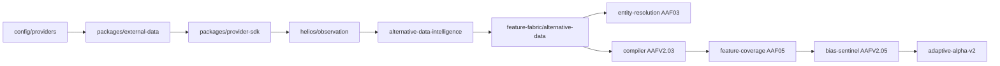

# HELIOS Alternative Data — Architecture (ALT01)

## Placement

ALT01 sits between **ingestion** (`packages/external-data`) and **strategy research** (Feature Fabric compiler, AAF V2, Strategy Lab bridges). It does not own provider HTTP, a second registry, or execution.

## Canonical owners

Reuse is documented in `ALT01_CANONICAL_OWNER_REUSE` and `ALT01_EXPLICIT_NON_OWNERS` under:

- `packages/platform/src/helios/alternative-data-intelligence/canonical-owners.ts`

Explicit non-owners include a second external-data plane, provider registry, Feature Fabric, entity resolver, Evidence Vault, or Strategy Lab.

## Schemas

| Schema ID | Owner |
|-----------|--------|
| `sunrey.helios.alt01.alternative-data-intelligence.v1` | `alternative-data-intelligence` |
| `sunrey.helios.alt01.feature-fabric.alternative-data.v1` | `feature-fabric/alternative-data` |

Temporal observations use kind `ALT_DATA` (existing `TEMPORAL_OBSERVATION_KINDS` entry). Universal feature family `ALTERNATIVE_DATA` is unchanged.

## Observation envelope

Every `AlternativeDataObservation` supports, where applicable:

- `eventTime`, `sourcePublishedAt`, `providerAvailableAt`, `sunreyArrivalTime`, `knowableAt`
- `revisionId`, `sourceRef`, `providerId`, `licenseClass`, `entitlementRef`
- `entityLink` / `entityLinkConfidence`, `geographicCoverage`, `qualityState`

Knowability follows `packages/platform/src/helios/observation/information-time.ts` (max of availability, arrival, ingestion). Period-end or event time alone never defines knowability.

## Intelligence plane

`AlternativeDataIntelligenceFabric`:

1. Registers manifests and series
2. Ingests observations (frozen, `grantsExecutionAuthority: false`)
3. `compilePlane({ evaluationTime })` filters by knowableAt, computes features, builds coverage tensor digests, emits `ALT_DATA` temporal rows

## Feature Fabric slice

`PointInTimeAlternativeDataFabric`:

1. Validates backfill rules on ingest
2. Appends AAF06 revision-ledger entries
3. Exposes `compileFeaturePlane` aligned with macro-intelligence patterns

## Integration hooks

| Bridge | Purpose |
|--------|---------|
| `external-data-bridge.ts` | Wave 5/6 category → signal family mapping |
| `adaptive-alpha-bridge.ts` | Coverage digest context for AAF V2 pipeline |
| `ingest.ts` (fabric) | Revision ledger + temporal observation mapping |

## Qualification

Engineering qualification: `evaluateAlt01Qualification` → `HELIOS_ALT01_CANONICAL_FABRIC_QUALIFIED` when checks pass.

Fabric slice qualification: `evaluateAlt01FabricQualification` → `HELIOS_ALT01_POINT_IN_TIME_ALTERNATIVE_DATA_QUALIFIED`.

## Simulation posture

ALT01 inherits repository simulation invariants: no `LIVE_*` changes, no live provider network from this plane.
