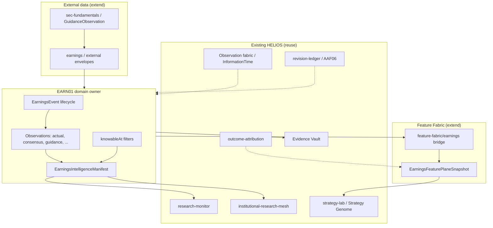

# EARN01 — HELIOS Earnings Intelligence architecture

**Schema:** `sunrey.helios.earn01.earnings-intelligence.v1`  
**Canonical authority:** `packages/platform/src/helios/earnings-intelligence`  
**Qualification:** `HELIOS_EARN01_DOMAIN_QUALIFIED`

This document defines how earnings intelligence **extends** existing HELIOS architecture. It does not introduce parallel platforms.

---

## 1. Design principles

1. **One domain owner** for earnings events and observations; Feature Fabric and external-data are **extensions**, not duplicates.  
2. **Information time is law** — no artifact is visible in manifests, feature planes, or mesh artifacts before its `knowableAt` (aligned with H08, AAF02, OS10, AAF10).  
3. **Research only** — every artifact carries `grantsExecutionAuthority: false` (and `grantsFinancialMutation: false` on events).  
4. **Provenance** — `sourceRefs` and `evidenceRefs` bind to Evidence Vault and SEC/fundamental lineage where applicable.  
5. **Simulation posture** — external adapters remain certification/fixture-first until explicitly promoted through existing trust and AAF V2 gates.

---

## 2. Layered architecture

---

## 3. Canonical owners

| Path | Responsibility |
|------|----------------|
| `packages/platform/src/helios/earnings-intelligence/` | Types, taxonomy, in-memory store, manifest compiler, leakage guards, EARN01 qualification |
| `packages/platform/src/helios/feature-fabric/earnings/` | Feature IDs, PIT earnings feature plane from manifest, `FeatureContributionInput` bridge |
| `packages/external-data/src/earnings/` | Provider-neutral external observation envelopes; SEC guidance mapping |

**Do not create:** `packages/earnings-engine`, `packages/earnings-fabric`, duplicate event-intelligence trees, or mesh forks.

---

## 4. Core domain model

### 4.1 Event lifecycle

`EarningsAnnouncementState`:

| State | Meaning |
|-------|---------|
| `EXPECTED` | Calendar / vendor expected date (may lack confirmed time) |
| `CONFIRMED` | Issuer or authoritative source confirmed schedule |
| `RELEASED` | Results published (press release, filing, or feed) |
| `CALL_SCHEDULED` | Earnings call on calendar |
| `CALL_COMPLETED` | Call finished; transcript may follow |
| `AMENDED` | Restatement or schedule change |
| `CANCELLED` | Event cancelled |
| `UNKNOWN` | Insufficient evidence to classify |

`EarningsSessionClassification` (`BEFORE_MARKET`, `DURING_MARKET`, `AFTER_MARKET`, `NON_TRADING_DAY`, `UNKNOWN`) is **orthogonal** to announcement state and is used for market-reaction windows and monitor triggers.

### 4.2 Temporal envelope

All observations and events embed:

- Identity: `canonicalEntityId`, optional `canonicalInstrumentId`, `fiscalPeriod`  
- Clocks: `eventTime`, `publishedTime`, `providerAvailabilityTime`, `sunreyArrivalTime`, **`knowableAt`**  
- Lineage: `revisionId`, `sourceRefs[]`, `evidenceRefs[]`  
- Quality: `qualityState` (H08 `QualityState` vocabulary)

`knowableAt` is the **visibility instant** for PIT queries. Economic period-end alone must not define knowability (same rule as `feature-fabric/knowable-at.ts`).

### 4.3 Manifest

`compileEarningsIntelligenceManifest({ evaluationTime, snapshot })`:

1. Filters store contents with `filterKnowableEarningsArtifacts(evaluationTime, …)`.  
2. **Fails closed** via `assertNoEarningsLeakage` if any non-knowable row is present.  
3. Emits sealed manifest metadata (`manifestId`, `compiledAt`) for Evidence Vault binding in later WPs.

---

## 5. Feature Fabric extension

Feature plane schema: `sunrey.helios.earn01.earnings-feature-plane.v1`

Initial feature IDs (formula version `earn01.v1`):

- `earn01.consensus_eps`, `earn01.actual_eps`, `earn01.eps_surprise_bps`  
- `earn01.guidance_revision`, `earn01.implied_move_bps`, `earn01.post_release_reaction_bps`  
- `earn01.announcement_state`, `earn01.session_classification`

`compileEarningsFeaturePlaneFromManifest` computes surprise only when **both** consensus and actual are knowable at `evaluationTime`. Surprise knowableAt is the **later** of the two inputs.

`earningsObservationsToContributions` produces standard `FeatureContributionInput` rows for the universal fabric compiler path (AAF V2 integration deferred to EARN03).

---

## 6. External data bridge

`mapSecGuidanceToExternalEarningsEnvelope` maps existing `GuidanceObservation` rows into `ExternalEarningsObservationEnvelope` without bypassing SEC `knowableAt`.

Future vendor adapters should:

1. Emit external envelopes only.  
2. Map into domain `EarningsGuidanceSnapshot` / related types in the domain owner (not in services).  
3. Pass through `ExternalDataTrustEngine` and AAF certification where market-data rules apply.

---

## 7. Integration map (existing systems)

| System | Integration |
|--------|-------------|
| **SEC fundamentals (OS10)** | Facts and guidance remain authoritative in `sec-fundamentals/`; earnings domain references same entity IDs and evidence refs |
| **Revision ledger (AAF06)** | Earnings revisions use `revisionId` + future adapter hooks to `revision-ledger` chains (not duplicated) |
| **AAF V2 certification** | Dataset certification gates before promoting fixtures to “research-qualified” planes |
| **Agentic Capital Mesh** | `EarningsResearchAgent` continues to run via mesh; consumes manifests by reference (EARN04) |
| **Research Monitor** | Expression features can consume earnings feature plane outputs (EARN05) |
| **M14 event intelligence** | Macro/market-moving events stay in `multi-asset/event-intelligence/`; corporate earnings events are **EARN01** unless explicitly cross-linked by ID |
| **Strategy Lab / Strategy Genome** | Strategies consume features through existing genome and evaluation chronology — no new lab |
| **Outcome attribution** | Post-release reaction features feed attribution studies after EARN03+ |

---

## 8. Leakage and safety

| Mechanism | Location |
|-----------|----------|
| `filterKnowableEarningsArtifacts` | `earnings-intelligence/knowable-at.ts` |
| `assertNoEarningsLeakage` | manifest compile |
| `isFeatureVisibleAt` | feature-fabric bridge |
| Simulation flags | `packages/config` — unchanged |

Kernel, ledger, and Execution Authority are **not** in this data path.

---

## 9. Qualification

`evaluateEarn01DomainQualification` returns:

- `HELIOS_EARN01_DOMAIN_QUALIFIED` when structural checks pass  
- `HELIOS_EARN01_DOMAIN_BLOCKED` otherwise  

Automated proof: `tests/helios-earn01-earnings-intelligence-domain.test.ts`.

This marker certifies **domain foundation only**, not production earnings feeds or strategy readiness.

---

## 10. Versioning

- Bump `HELIOS_EARNINGS_INTELLIGENCE_SCHEMA` for breaking domain changes.  
- Bump `EARNINGS_FEATURE_FORMULA_VERSION` when feature semantics change.  
- Keep Strategy Genome and AAF manifests in sync when new earnings features graduate from EARN03.
