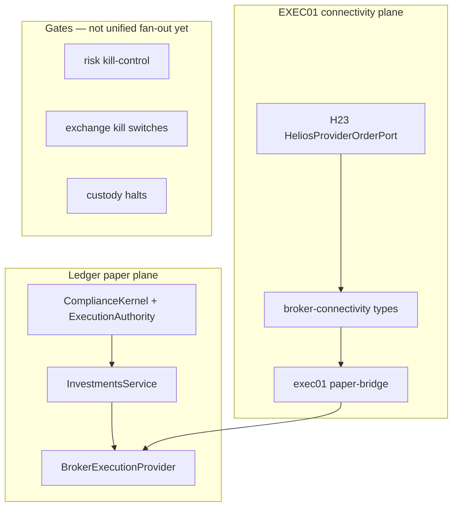

# HELIOS Execution Connectivity — Architecture (EXEC01)

## Objective

Establish the canonical **production-shaped external execution connectivity** domain for broker, execution, and custody by **extending existing SunRey owners**. EXEC01 defines types, connectivity states, and port bridges. It does **not** activate live brokerage or imply legal authorization.

**Qualification marker:** `HELIOS_EXEC01_CONNECTIVITY_DOMAIN_QUALIFIED`  
**Posture:** `LIVE_INVESTMENT_EXECUTION=false` (unchanged).

## Canonical owners (extend only)

| Owner | Role |
|-------|------|
| `packages/investments/src/broker-port.ts` | `BrokerExecutionProvider` + `PaperBrokerProvider` (paper path unchanged) |
| `packages/investments/src/broker-connectivity/` | EXEC01 canonical broker DTOs and paper bridge |
| `packages/investments/src/product/execution.ts` | `InvestmentExecutionAdapter` product facade |
| `packages/platform/src/helios/order-lifecycle/` | H23 `HeliosProviderOrderPort`, settlement, reconciliation |
| `packages/platform/src/helios/execution/exec01/` | Audit map, H23 bridge, qualification |
| `packages/platform/src/helios/provider-orchestration/` | H22 provider accounts and wallets |
| `packages/platform/src/helios/executable-opportunity/` | H09 execution routes |
| `packages/platform/src/helios/capital-lifecycle/` | H24 exits and cash availability |
| `packages/sunrey-exchange/src/regulated/` | Market access and exchange kill switches |
| `packages/custody/src/provider-candidate/` | Custody settlement reconciliation candidates |
| `packages/custody/src/regulated/exec01-broker-settlement.ts` | Broker settlement scope typing |
| `packages/risk/src/investments/exec01-capital-reservation.ts` | Capital reservation facts |
| `packages/risk/src/portfolio/kill-control.ts` | Portfolio kill triggers |
| `packages/kernel/src/policy/seed.ts` | Investment `ActionIntent` seeds |
| `packages/kernel/src/regulated/exec01-investment-execution.ts` | Connectivity gate references |

Explicit non-owners are listed in `EXEC01_EXPLICIT_NON_OWNERS` (`packages/platform/src/helios/execution/exec01/canonical-owners.ts`).

## Production-shaped types

Declared in `packages/investments/src/broker-connectivity/types.ts`:

- `BrokerProvider` — canonical adapter contract (`grantsExecutionAuthority: false`)
- `BrokerAccount`, `BrokerSession`
- `BrokerOrderRequest`, `BrokerExecutionReport`, `BrokerFill`
- `BrokerPosition`, `BrokerCashBalance`, `BrokerBuyingPower`
- `BrokerSettlement`, `BrokerCorporateAction`

Schema: `sunrey.helios.execution.connectivity.exec01.v1`

Money uses **integer minor-unit strings**. Quantities use **scaled unit strings** (no floating point).

## Connectivity states

Engineering states only — **no state implies legal authorization**:

| State | Meaning |
|-------|---------|
| `REGISTERED` | Metadata recorded; no outbound API |
| `SANDBOX` | Fixture/injected transport; EXEC01 DTO conformance |
| `READ_ONLY_CONNECTED` | Positions/cash readable; order entry off |
| `ORDER_ENTRY_CONFORMANCE` | Submit/cancel/query against conformance harness |
| `EXTERNAL_GATES_PENDING` | Engineering complete; human/regulatory gates open |
| `PRODUCTION_DISABLED` | Explicit posture while `LIVE_INVESTMENT_EXECUTION` is false |

## Execution planes (coexistence)

1. **Ledger paper** — `InvestmentsService` + `PaperBrokerProvider` (unchanged).  
2. **Product** — `InvestmentExecutionAdapter` + sandbox provider.  
3. **HELIOS H23** — `HeliosOrderLifecycleService` + `HeliosProviderOrderPort`.  
4. **EXEC01** — unifies vocabulary; `h23-bridge.ts` maps H23 ↔ broker DTOs.

## Authorization and capital

- **Kernel:** Ledger mutations require `ComplianceKernel.submit` → verified `ExecutionAuthority` on the investments path. H23 stores `authorityReference` from injected `kernelPermits`; it does not mint authority.  
- **Capital reservation:** Four models coexist (accounts holds, investments `CashReservation`, `HeliosCapitalPort`, H24). EXEC01 adds `BrokerCapitalReservationPort` facts in risk.  
- **Kill switches:** Exchange, portfolio, custody, and grow-controls planes exist; composed broker halt fan-out remains future work (see M21–M24 closure).

## Qualification

Engineering qualification: `evaluateExec01Qualification` → `HELIOS_EXEC01_CONNECTIVITY_DOMAIN_QUALIFIED` when checks pass (`tests/helios-exec01-connectivity-domain.test.ts`).

## Simulation posture

EXEC01 inherits repository invariants: no `LIVE_*` changes, no live broker network, paper broker behavior unchanged.
