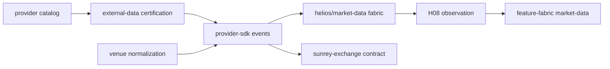

# HELIOS Market Data — Architecture (MD01)

## Objective

Upgrade HELIOS external market-data infrastructure into the canonical **production-shaped market observation fabric**. MD01 is **MARKET_OBSERVATION_ONLY**: no market-data event creates Execution Authority.

## Canonical owners (extend only)

| Owner | Role |
|-------|------|
| `packages/provider-sdk/src/market-data-capability/` | Event schema `sunrey.market-data-event.v1` + capability contract |
| `packages/provider-sdk/src/venue/` | Venue normalization → `MarketTradeEvent` / `MarketQuoteEvent` / `MarketBookSnapshot` |
| `packages/external-data/src/certification/market-data/` | Certification alignment for admitted event kinds |
| `packages/sunrey-exchange/src/market-data/` | Exchange observation contract (not a second price authority) |
| `packages/platform/src/helios/observation/` | H08 envelope, information-time, entitlement |
| `packages/platform/src/helios/feature-fabric/market-data/` | Evidence-time features from sealed events |

Explicit non-owners are listed in `MD01_EXPLICIT_NON_OWNERS` (`packages/platform/src/helios/market-data/md01/canonical-owners.ts`).

## Event model

Thirteen canonical kinds:

`MarketTradeEvent`, `MarketQuoteEvent`, `MarketBookUpdate`, `MarketBookSnapshot`, `MarketStatusEvent`, `AuctionEvent`, `ImbalanceEvent`, `ReferencePriceEvent`, `SettlementPriceEvent`, `OpenInterestEvent`, `FundingRateEvent`, `IndexPriceEvent`, `MarkPriceEvent`.

Every event carries:

`instrumentId`, `venueId`, `providerId`, `sourceFeedId`, `sourceSequence`, `eventTime`, `exchangeTime`, `providerPublishTime`, `sunreyReceiveTime`, `normalizedTime`, `knowableAt`, `sourceRef`, `entitlementRef`, `qualityState`.

Prices and quantities are **decimal strings** (fixed-point), never floating-point money.

## Data flow

## Qualification

Engineering qualification: `evaluateMd01Qualification` → `HELIOS_MD01_MARKET_DATA_FABRIC_QUALIFIED` when checks pass (`tests/helios-md01-market-data-fabric.test.ts`).

## Simulation posture

MD01 inherits repository simulation invariants: no `LIVE_*` changes, no live provider network from this plane.
