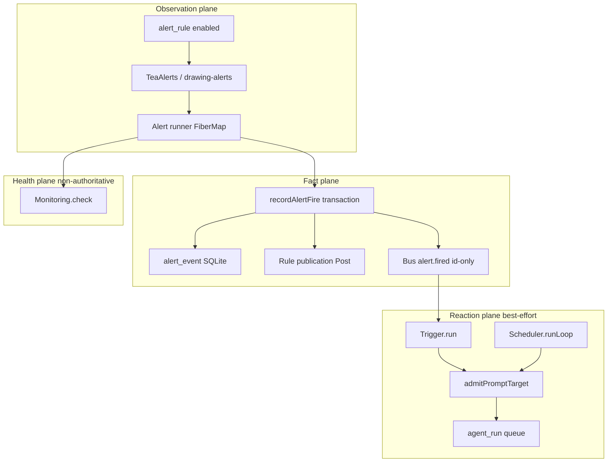

# OpenChart → HELIOS Monitor Map (OS06)

**Program:** HELIOS Open-Source Integration  
**Work package:** OS06 — event, monitor, trigger, and agent architecture map  
**Upstream:** [longsurf-ai/openchart](https://github.com/longsurf-ai/openchart)  
**Reference SHA:** `8109466bfb5d44c32e0e03e9337eaca48b837ab4`  
**Upstream license:** MIT  
**Status:** Architecture map only — **no behavioral integration**, no vendored code, no UI import.

This document audits OpenChart’s server-side, event-driven market monitoring stack and maps reusable concepts into canonical HELIOS owners. It does not change runtime behavior on `main`.

---

## 1. Executive summary

OpenChart implements a **three-stage reactive pipeline** on a single process:

1. **Observe** — long-lived fibers evaluate market conditions (`Alertable` → Tea, drawing geometry, or indicator-following rules).
2. **Record** — durable `alert_event` rows and id-only bus messages (`alert.fired { ruleId, eventId }`) after transactional revision checks.
3. **React** — best-effort **Triggers** (notification or agent prompt admission) and **Scheduler** fires (cron / one-shot), both sharing `admitPromptTarget` and immutable **intents**.

Cross-cutting concerns:

| Concern | OpenChart owner | Character |
|--------|------------------|-----------|
| Live invalidation | `server/events` + Resource change callbacks | Process-local PubSub, no durable replay |
| Health | `server/monitoring` | In-memory; green must be re-earned |
| Background loops | `*/background.ts` | Scoped Effect fibers; joined on shutdown |
| Market DSL | `server/tea` + `common/tea` | Compiled scripts over Feed bars |
| Agent execution | `server/agent` | Durable `agent_run` queue; permission gate |

HELIOS already separates **ingestion** (H07/H08), **coordination** (H04/H06 work orders), **research** (Strategy Lab, Agentic Capital Mesh), **allocation review** (H20), and **audit** (Evidence Vault). OpenChart’s monitor stack is a useful **reference design** for how to wire observation → sealed facts → bounded reactions without conflating delivery with truth.

---

## 2. OpenChart architecture (audited scope)

### 2.1 End-to-end alert → trigger flow

Canonical contract: `docs/architecture/alert-trigger.md` (upstream).



**Design choices worth preserving in HELIOS mapping:**

- **Updates only, no snapshot replay** for fires — avoids false positives after restarts; HELIOS should not backfill “missed” monitor fires as if they were economic events.
- **Revision-gated recording** — stale fibers cannot commit after rule/indicator/drawing edits.
- **Id-only bus** — consumers re-read Resources; aligns with HELIOS envelope + lineage IDs rather than fat events.
- **Best-effort triggers** — history proves the condition; delivery and agent success are orthogonal (explicit in upstream docs).

### 2.2 Module inventory (server)

| Path | Responsibility | Lifecycle / execution |
|------|----------------|-------------------------|
| `server/alert/` | `Alertable` protocol, Tea/drawing/indicator observation, `recordAlertFire`, starters/conditions | One fiber per enabled rule; jittered retry; Monitoring `alert/<ruleId>` |
| `server/events/` | Typed PubSub, `withBarrier`, SSE router adapter | No central manifest, no durable log |
| `server/feed/` | Bars/series/calendar/symbology services, versioned Feed composition | Snapshots then updates; explicit gap/overflow failure |
| `server/monitoring/` | Check → Status aggregation, `monitoring.changed` | In-memory; 60s interruption hold |
| `server/proactive/` | Read-only starter prompts (not agent-specific) | No execution |
| `server/scheduler/` | Cron/one-shot scan, cursor advancement, `schedule:<id>:<fireAt>` intent | 30s loop; sequential admit after read tx |
| `server/trigger/` | Match `alert.fired`, template render, notification / agent target | Orphan sweep; overflow resubscribe (gap loss) |
| `server/agent/` | Sessions, Runs, Processor, permission, recovery | `submitPrompt` single entry; serialized per session |
| `server/tea/` | Compile/observe Tea over Feed | Warmup bars; nominal Alert column detection |

### 2.3 Shared contracts (common)

| Path | Responsibility | HELIOS relevance |
|------|----------------|------------------|
| `common/feed/` | Bars/series schemas, `FeedError`, ticker ids | Provider-scoped listings — maps to H07 instrument identity, not cross-provider merge |
| `common/market/` | Bar columns, session, listing vocabulary | M01/M04 instrument + session context |
| `common/timeseries/` | Arrow DataFrame codec, time range semantics | Observation payload shape for H08 envelopes (not a second store) |
| `common/tea/` | `NodeConfig`, Alert nominal types, parameter rules | Feature Fabric DSL reference (OS08) |

### 2.4 Focus topics → OpenChart mechanisms

| Focus | OpenChart mechanism | Key files / docs |
|-------|---------------------|------------------|
| Condition monitoring | `Alertable.observe()` stream, Tea Alert columns, drawing boundary geometry | `alert/alertable.ts`, `alert/tea-alerts.ts`, `alert/drawing-alerts.ts` |
| Event streams | Resource → Events; `allBounded` subscription | `events/events.ts`, `events/router.ts` |
| Alerts | Rule fiber + transactional fire + Once semantics | `resources/macros/record-alert-fire`, `alert/background.ts` |
| Triggers | Bus consumer, token render, agent/notification targets | `trigger/trigger.ts`, `trigger/serialize.ts` |
| Background execution | `Layer.effectDiscard` + `Effect.forkScoped` | `alert/background.ts`, `trigger/background.ts`, `scheduler/background.ts` |
| Proactive agents | Starter prompts only; action via normal agent path | `proactive/proactive.ts` |
| Agent permissions | Profile rules + ask/allow/deny; mutation lock | `server/agent/permission/` |
| Scheduling | Eligibility scan, intent idempotency, cursor rules | `scheduler/scheduler.ts` |
| Market logic DSL | Tea compile/run, indicator follow, conditions builder | `server/tea/*`, `common/tea/alerts.ts` |
| Monitor lifecycle | FiberMap dispose on rule change; enabled/disabled/Once | `alert/alert.ts` |
| Source-linked analysis | Agent trigger adds Post + alert_event refs; `post-context.ts` | `trigger/post-context.ts`, agent prompt parts |

---

## 3. HELIOS target surfaces (canonical owners on `main`)

| HELIOS surface | Canonical owner (code) | Work packages | Role relative to OpenChart |
|----------------|------------------------|---------------|----------------------------|
| **Observation Fabric** | `packages/platform/src/helios/observation` (`HeliosObservationFabric`) | H08; M02 ingest bridge | Sealed market observations, information-time, lineage — **upstream of** any monitor |
| **Feature Fabric** | *Program seam (not a separate package on `main`)* — host: `packages/platform/src/helios/multi-asset` (market state, regime, intelligence) + evaluation: `packages/strategy-lab` | M04, M13–M16; H16–H18 | Derived features / DSL outputs over sealed observations (OpenChart Tea + indicators) |
| **Economic Work Orders** | `packages/platform/src/work-order` (H04) + execution: `packages/platform/src/helios/orchestrator.ts` (H06) | H04, H05, H06 | Bounded scope, mandate, budget — **wraps** monitor/research tasks |
| **Agentic Capital Mesh** | `packages/agentic-capital-mesh` | H19, Chunk 21 | Proposal-only mesh; reacts to **qualified** opportunities, not raw alert bus |
| **Strategy Lab** | `packages/strategy-lab` | H16–H18, M09–M12 | Deterministic capsules, promotion — **consumer** of feature snapshots |
| **Evidence Vault** | `packages/evidence` | Kernel + HELIOS audit helpers | Hash-chained seals for decisions, work-order audit, regulatory triggers |
| **H20 Meta Allocator** | `packages/platform/src/helios/meta-allocator` | H20 | Allocation **review** for ranked opportunities — not alert-driven trading |

Constitution reminder: no second ledger, Kernel, Execution Authority, or agent financial mutator. OpenChart’s agent path is **analysis and publication**, not order placement — compatible with SunRey agent boundaries when mapped to proposal-only flows.

---

## 4. Concept mapping matrix

Legend: **Adopt pattern** = reuse design; **Adapt** = new implementation behind existing port; **Reject** = do not port (policy or scope).

| OpenChart concept | HELIOS surface | Mapping | Notes |
|-------------------|----------------|---------|-------|
| Feed bars/series snapshot + update | Observation Fabric | Adapt → H08 ingest | H07 routes (`packages/sunrey-exchange/.../helios.ts`) fetch; fabric seals envelopes |
| `FeedVersion` invalidation | Observation Fabric | Adapt | Map to freshness + sequence gap policies (`observation/quality.ts`) |
| Tea script / indicator outputs | Feature Fabric | Adapt | Strategy Lab rules + M04 market state; no live OpenChart compiler on Kernel path |
| `Alertable` + live stream | Feature Fabric + EWO | Adapt | Long-running monitor = **work order** task type `MONITORING` (taxonomy) under H06 orchestrator |
| `alert_event` durable facts | Evidence Vault + Observation lineage | Adapt | Store monitor firings as evidence-linked observation events, not ledger postings |
| `alert.fired` id-only bus | `packages/events` (domain) | Adopt pattern | Durable outbox where required; process-local bus insufficient for multi-service HELIOS |
| Trigger template `{token}` render | Agentic Capital Mesh / Strategy Lab | Adapt | Deterministic token render for human-readable briefs; no hidden field inference |
| `admitPromptTarget` + intent | Economic Work Orders + `packages/ai-runtime` | Adapt | Intent = idempotency key per work-order task; S3M/Grok behind H10–H12 contracts |
| Scheduler cron + cursor | Economic Work Orders | Adapt | Recurring research/monitor schedules as scoped work orders, not implicit cron in BFF |
| Permission ask/allow/deny | `packages/sunrey-agent` mandates + Kernel | Adapt | Mesh/agent cannot widen mandate; align with Chunk 98 ProposalGate |
| Monitoring Check/Status | HELIOS operational read models | Adapt | Non-authoritative health; H31 resilience scenarios already expect degraded data, not fabrication |
| Proactive starter prompts | Consumer BFF / agent UX | Reject for OS06 | UI/product copy — not server monitor architecture |
| Desktop notifications | — | Reject | Explicitly out of scope |
| Drawing/chart geometry alerts | Feature Fabric | Defer | Geometry boundary logic is chart-domain specific; HELIOS may use instrument-level rules first |
| SQLite Resource transactions | `packages/persistence` | Adapt | Same revision/idempotency **ideas**, existing PG adapters |

---

## 5. Layered mapping (by HELIOS surface)

### 5.1 Observation Fabric (H08)

**OpenChart inputs:** `server/feed/*`, `common/feed`, `common/market`, `common/timeseries`.

| Mechanism | Map to HELIOS |
|-----------|---------------|
| Provider-scoped listings, bars request `from/to/countBack` | H07 market data adapter + M01 canonical instrument IDs |
| Hose snapshot-before-updates | Ingest ordering in `HeliosObservationFabric.ingest` — information-time, no look-ahead |
| Explicit `FeedError` / retryability | Provider orchestration (H22) and resilience (H31) — fail closed, no synthetic bars |
| Series by source id | Lineage + `upstreamSourceRef` on envelopes |

**Non-goals:** OpenChart’s in-process Feed composition root does not replace SunRey provider-sdk certification or Chunk 151 sandbox adapters.

### 5.2 Feature Fabric (program seam)

**OpenChart inputs:** `server/tea/*`, `common/tea`, `server/alert/tea-alerts.ts`, `alert/starters.ts`, `alert/conditions.ts`.

| Mechanism | Map to HELIOS |
|-----------|---------------|
| Compiled `NodeConfig` + warmup bars | Deterministic feature pipelines in multi-asset market state (M04) and Strategy Lab fixtures |
| Nominal `visual.Alert` / `AlertEvent` columns | Typed “feature fired” records attached to observation lineage (not Exchange orders) |
| Indicator-follow rules | Feature dependency graph: indicator revision + instrument snapshot at fire time |
| Conditions builder (bounded tree) | Strategy Lab capsule inputs — prefer explicit templates over arbitrary decompile |
| Drawing-derived Tea | Defer — optional future geometry port; not required for capital monitoring MVP |

**Non-goals:** Do not embed OpenChart workspace/LSP or chart renderer. Do not run unaudited Tea with network imports in production paths.

### 5.3 Economic Work Orders (H04/H06)

**OpenChart inputs:** `server/scheduler/*`, `server/trigger/*` (agent leg), `server/agent/session/*`, background fibers.

| Mechanism | Map to HELIOS |
|-----------|---------------|
| Immutable intent (`schedule:…`, `trigger:…`) | Work-order task idempotency + `HeliosWorkOrchestrator` task creation |
| `runNow` vs disabled schedule | Work order **PAUSED** vs manual dispatch — preserve operator intent |
| Sequential admit after read transaction | Orchestrator serializes task admission; budget / concurrency caps (H31 CAP scenarios) |
| Best-effort trigger | Task outcome `COMPLETED` vs `FAILED` without implying economic execution |
| Agent Run queue | H06 durable work execution store + async inference (H10) when tasks require LLM |

**Non-goals:** Triggers must not call `openAccount`, `Ledger.postJournal`, or Exchange placement without Kernel ALLOW + Execution Authority.

### 5.4 Agentic Capital Mesh

**OpenChart inputs:** Agent trigger targets, `post-context.ts`, publication instructions in prompts.

| Mechanism | Map to HELIOS |
|-----------|---------------|
| Source-linked analysis (Post + alert_event refs) | Mesh evidence bundles (M15 bridge) — cite observation IDs and envelope hashes |
| Independent sequential trigger dispatch | Mesh node proposals that **reference** monitor firings; adversarial review unchanged |
| Agent cannot save triggers in place of user | Mesh cannot self-validate (`packages/strategy-lab/src/bridges.ts` pattern) |

**Non-goals:** Raw alert stream must not auto-create capital proposals without mandate scope and work-order binding.

### 5.5 Strategy Lab

**OpenChart inputs:** Condition templates, Tea outputs, scheduled research prompts.

| Mechanism | Map to HELIOS |
|-----------|---------------|
| Rule evaluation cadence | Shadow/paper/backtest modes (M09–M12) — chronological evaluation (H17) |
| Alert frequency decided by script | Lab defines explicit bar/step semantics; no silent tick flooding |
| Promotion pipeline | H18 gates — monitor rules graduate to paper only through qualification markers |

### 5.6 Evidence Vault

**OpenChart inputs:** Transactional `recordAlertFire`, revision checks, alert history as read-only facts.

| Mechanism | Map to HELIOS |
|-----------|---------------|
| Atomic fire + Once disable | Seal monitor emission record with content hash + rule/instrument revisions |
| History without delivery status | Evidence records **fact emitted**; separate optional delivery audit |
| Regulatory-style triggers | Parallel to `packages/platform/src/helios/regulatory-evidence/trigger-engine.ts` — policy-driven, not OpenChart Bus |

### 5.7 H20 Meta Allocator

**OpenChart inputs:** Indirect — agent triggers that “publish analysis” after a fire.

| Mechanism | Map to HELIOS |
|-----------|---------------|
| Monitor → analysis → action | **Not** a direct wire: Meta Allocator consumes M16-ranked, `QUALIFIED_FOR_ALLOCATION_REVIEW` candidates only |
| Alert-driven reallocation | Requires opportunity assembly + ranking; monitor events may **enqueue research** work orders only |

---

## 6. Monitor lifecycle (conceptual HELIOS state machine)

OpenChart lifecycle (enabled rule):

```text
DISABLED → (enable) → START_FIBER → OBSERVE_STREAM
    ↑                        │
    │                        ├─ evaluation ok, no alert → stay (Monitoring healthy)
    │                        ├─ evaluation ok, alert → RECORD_TX → (optional) BUS → TRIGGERS
    │                        ├─ compile/feed error → RETRY_BACKOFF (Monitoring failed)
    │                        └─ rule revision / disable / delete → DISPOSE_FIBER
    └── Once: first successful RECORD_TX disables rule in same transaction
```

Proposed HELIOS binding (future OS07+ behavior):

| State | Owner | Persistence |
|-------|-------|-------------|
| Monitor definition | Feature Fabric metadata | Customer DB via `packages/persistence` |
| Running evaluation | H06 task `ACTIVE` | Orchestrator store |
| Emitted feature fire | H08 lineage + Evidence Vault | Sealed envelope + vault record |
| Reactions (research, notify, mesh) | H04 work-order tasks | Task ledger + evidence |
| Health | Operational metrics | Non-authoritative (H31) |

---

## 7. Explicit non-imports (OS06)

Do **not** port from OpenChart:

- UI, chart rendering, drawing editor, alert lines, Copilot chrome, Feed page layout
- Branding, desktop notification host, macOS sound catalog wiring
- Electron/main-process notification adapters
- SQLite-specific Resource UI macros as product surfaces
- OpenChart `server/bus` as a substitute for SunRey durable events where cross-service guarantees are required

---

## 8. OS07 / OS08 — canonical owners (confirmed)

OS06 stops at architecture mapping. The next open-source tracks split by **plane**, not by duplicating OS06’s monitor map.

| Track | Scope | Canonical owner on `main` | Rationale |
|-------|--------|---------------------------|-----------|
| **OS07** | **Observation & feed plane** — OpenChart `server/feed`, `common/feed`, `common/market`, `common/timeseries`; behavioral integration of provider-scoped bars/series into sealed H08 envelopes and M02 market observations | **`packages/platform/src/helios/observation`** (primary), with ingress **`packages/sunrey-exchange/src/capital-market`** (H07) and **`packages/platform/src/helios/market-observation`** (M02 bridge) | Ingestion and provenance must stay unified in Observation Fabric; exchange capital-market adapters remain the configured provider path in simulation |
| **OS08** | **Feature & DSL plane** — OpenChart `server/tea`, `common/tea`, indicator/condition/starter semantics; behavioral integration of derived features and monitor definitions | **`packages/strategy-lab`** (deterministic evaluation, capsules, promotion) **plus** **`packages/platform/src/helios/multi-asset`** (market state, regime, intelligence layers as Feature Fabric host) | DSL and feature lifecycle belong with strategy research and multi-asset intelligence, not with ledger, Kernel, or a new `packages/feature-fabric` |

**Cross-cutting (both tracks):** background scheduling and agent admission patterns from OS06 map to **`packages/platform/src/helios/orchestrator.ts`** (H06) and **`packages/platform/src/work-order`** (H04), with LLM dispatch via **`packages/ai-runtime`** (H10–H12). Agentic Capital Mesh (**`packages/agentic-capital-mesh`**) remains a **consumer** of sealed features and work-order outputs, not owner of ingest or DSL.

---

## 9. Integration risks (SunRey / HELIOS policy)

| Risk | Mitigation |
|------|------------|
| Treating alert delivery as economic truth | Separate vault fact from notification/task outcome |
| Monitor bypassing work-order mandate | All recurring/LLM reactions require H04/H05 binding |
| Live provider enablement | Keep `ENVIRONMENT=simulation`; no `LIVE_*` changes from integration |
| Agent order placement | Route proposals through ProposalGate → Kernel; never copy OpenChart tool save paths into accounts |
| Fabricated market data on feed failure | Align with H08 “never invent synthetic fallback values” |
| Percentage-return fields in monitor payloads | Forbidden in HELIOS growth/attribution surfaces |

---

## 10. Suggested follow-up (outside OS06)

1. **OS07** — spike: map one OpenChart bars fixture into `HeliosObservationFabric.ingest` via H07 sandbox route.  
2. **OS08** — spike: express one OpenChart starter condition as a Strategy Lab capsule input schema.  
3. **OS06+** — add FAST_CI fixture: monitor emission seals evidence without posting journals.  

---

## References

- Upstream: `docs/architecture/alert-trigger.md`, `scheduler.md`, `agent.md`, `feeds.md`, `tea.md` @ `8109466b…`
- HELIOS: `docs/helios/H01_RUNTIME_TRUTH_MAP.md`, `docs/helios/HELIOS_MULTI_ASSET_M01_M04_CLOSURE.md`, `packages/platform/src/helios/observation/fabric.ts`
- Authority: `docs/architecture/constitution.md` (Agentic Capital Mesh, Strategy Lab, Evidence Vault)
